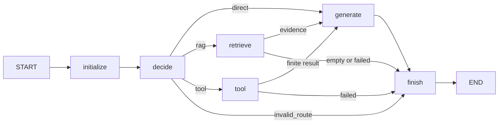

# KnowledgePilot V1.5 源码教学交接

日期：2026-10-27（Asia/Singapore）。工程交付，不是正式版本发布。

## 1. Git 身份

- 开发分支：`v1.5-langgraph-workflow`。
- 已核实本地和 GitHub 基线：`v1.4-step5-release-readiness` / `b5c760d425741d18d11d91377bcb74af46669246`。
- 实现及测试源码提交：`9f5208fb4e654421394ececf429a14c8bc55608f`。
- 本文与原始验收证据在后续文档提交交付；最终分支 HEAD 用 `git log -1 --format=%H` 核实，不能将源码 SHA 当作最终文档提交 SHA。
- worktree：`C:\Users\lenovo\.codex\.chatgpt-projects\g-p-6a9c0574f0648191afc307eb07a1456b\KnowledgePilot-v15`。
- 原主仓库 `D:\AI_develop\KnowledgePilot` 的 main 和未跟踪 `docs/interview/` 保留；未合并 main，未创建 Tag。

## 2. 文件与推荐学习顺序

下列路径均相对本 worktree：

1. `src/knowledge_pilot/workflow/schemas.py`：请求、模型决策、计算器参数、证据和响应 Schema。
2. `src/knowledge_pilot/workflow/graph.py`：State、六个 Node、两类条件路由及图编译/执行。
3. `src/knowledge_pilot/workflow/model.py`：原生 Ollama 结构化输出与响应校验。
4. `src/knowledge_pilot/api/workflow.py`：独立 API 路由；`api/app.py` 只增加两行路由注册。
5. `tests/test_workflow.py`、`test_workflow_api.py`、`test_workflow_model.py`：图行为、HTTP 契约与模型边界。
6. `scripts/verify_v15_workflow.py` 与 `tests/integration/test_workflow_e2e.py`：真实服务、真实工具及隔离检索的验收链。

其他新增：`workflow/__init__.py`、固定环境约束 `requirements-workflow-lock.txt`、实施计划 `docs/superpowers/plans/2026-10-27-v15-workflow.md`、本交接包与证据。修改：`requirements.txt`、`pyproject.toml` 增加固定 `langgraph==1.2.18`；README 增加使用说明。完整文件清单可执行 `git diff --name-status b5c760d..HEAD`。

## 3. 真实函数签名

- `workflow/graph.py:42`：`build_workflow(*, model=None, executor=None)`，返回编译后的图。
- `workflow/graph.py:136`：`run_workflow(request: WorkflowRequest | dict, *, model=None, executor=None) -> dict`，正式 Python 入口。
- `workflow/graph.py:36`：`production_executor(name: str, arguments: dict)`，延迟导入并调用旧 `tools.registry.execute_tool`。
- `workflow/model.py:9`：`ollama_message(messages: list[dict], schema: dict | None = None)`，复用 `llm.transport.post_json`。
- `api/workflow.py:13`：`workflow_chat(request: WorkflowRequest)`，调用 `run_workflow`。
- 图中的闭包节点均接收 `state: WorkflowState` 并返回局部更新字典；条件函数分别为 `after_decide(state: WorkflowState)`、`after_execution(state: WorkflowState)`。

## 4. State：谁读取，谁更新

`WorkflowState` 是 TypedDict，表示图内部可合并状态；它本身不承担运行时校验。边界由 Pydantic 负责。

- `request`：校验后的输入快照，初始化节点设置；决策/检索读取。内部保留，不回传。
- `query`：原始问题，由初始化设置，模型和检索读取，最终回传。
- `route`：初始化为请求路由，decide 更新成 direct/rag/tool；参与条件边，最终回传。非法模型决策时可保持 auto，同时 status 必须是 failed。
- `tool`：decide 写入校验过的计算器调用；tool 读取；不直接回传。
- `tool_result`：tool 写入有限数值，generate 读取，最终回传；初始 None。
- `evidence`：retrieve 写入经过 Schema 校验的内容和文件名；generate 读取，最终回传。文件来源去除宿主绝对路径。
- `answer`：generate 写入，空检索则由 retrieve 写固定说明；最终回传。
- `trace`：初始化清空后，每个节点按顺序追加自身名称；最终回传。每次调用独立，不跨请求共享。
- `error`：decide/retrieve/tool 写安全错误码；条件边读取，最终回传。原始异常文本不会写入结果。
- `status`：初始化 running；生成成功 completed，空检索 no_results，领域故障 failed。执行后的条件边据此跳过生成；最终回传时不允许 running。

这些字段均有用途，没有 session、长记忆、重试历史或多 Agent 协调字段。

## 5. Node、Edge 和真实调用链



- `initialize`：读取 request，校验输入，重置所有派生状态。不能信任调用者预填的 error/trace/evidence。
- `decide`：显式路由直接校验；auto 则将问题及 `Decision.model_json_schema()` 发给 Ollama，通过 `format` 获得 JSON。route 只允许三个值，tool 只允许 calculator，参数拒绝多余字段、未知操作、非有限数值；非工具路由不能携带 tool。
- `retrieve`：用原工具执行器执行 `search_knowledge_base(query, top_k, document_id)`，继续走原生产 Chroma/Embedding 搜索；不另建检索算法。空列表直接 no_results，避免无证据生成。
- `tool`：调用原工具执行器中的 calculator；验证结果是有限数值。除零及执行异常明确失败，不给模型一次虚构成功的机会。
- `generate`：直答使用普通回答提示；工具/RAG 使用证据约束提示。调用原生 Transport，不调用原 Agent Loop。对空回答或错误 Envelope 抛已有模型错误类型。
- `finish`：追加结束节点，接 END；没有后向边。

`after_decide` 是第一组条件边：错误→finish；direct→generate；rag→retrieve；tool→tool。
`after_execution` 是第二组条件边：仍 running→generate；no_results/failed→finish。
`compile()` 生成可执行图，`invoke()` 执行。最多五个业务节点、两次聊天请求、一次工具执行；recursion_limit=8 是附加防线，不是业务重试次数。

## 6. 原 Agent Loop 与 Workflow

原 `chat_with_ollama(messages, max_steps=5)` 仍由模型每轮决定 Tool Calling，执行结果以 Observation 写回下一轮，有原 trace、stop_reason 契约。

新 Workflow 是有界 DAG：路由一次，执行一个分支，必要时汇总一次。它展示 State 更新、条件边、执行结果驱动终止，适合已知流程；不宣称具备任意多步规划能力。旧 Agent 未封装进任何 Node。

工具白名单当前只有计算器；知识库检索是单独 RAG 分支。增加新工具需要同步 Schema、执行约束和测试，不能只相信模型输出名称。

## 7. API 与实际运行

请求示例：

```json
{"query":"6乘7是多少？","route":"tool","tool":{"name":"calculator","arguments":{"a":6,"b":7,"operation":"multiply"}}}
```

默认 route=auto；显式 direct/rag 不需要 tool，rag 可指定 top_k=1..20 和 document_id。query 长度 1..8000，拒绝空白。未知字段和非法组合返回 422。

响应固定包含 query、route、tool_result、evidence、answer、trace、error、status。领域失败仍返回可检查的 HTTP 200 响应，调用者必须先检查 status；不是 HTTP 成功就认定工具完成。模型不可用/超时/非法响应继续映射 503/504/502。模型错误由旧可靠性边界处理，不伪造 answer。错误 HTTP 响应沿用旧 detail 契约，不包含部分图状态。

```powershell
# 在本 worktree；专用环境已安装此 worktree 的 editable 包
./.venv/Scripts/python.exe -m uvicorn knowledge_pilot.api.app:app --host 127.0.0.1 --port 8000
./.venv/Scripts/python.exe -B scripts/verify_v15_workflow.py --evidence ./data/v15-check.json
./.venv/Scripts/python.exe -B scripts/verify_v15_workflow.py --evidence ./data/v15-real.json --real-ollama http://localhost:11434
```

正式使用读取用户配置的资料；验收器始终新建自有临时目录、覆盖数据根、关闭子进程并删除临时资料。生产执行器的旧 Registry 会初始化 Chroma；纯图/计算器节点单测使用边界注入，生产路径另由真实 HTTP 验收证明。

公开日志不应出现 query、证据正文、tool 原始参数、模型回复或原始异常值。新响应含用户查询和检索正文，供请求客户端使用，不是日志。正式 `run_workflow` 入口显式关闭 LangSmith tracing；高级调用者直接使用 build_workflow 返回的图时，应自行管理 callbacks/tracing，不能将其视为相同隐私边界。

## 8. 少量核心练习

1. State：在 `retrieve` 下断点，观察 evidence 更新之前/之后的内容；指出哪些字段更新、哪些沿用。
2. Node：解释为什么返回 `{'trace': state['trace'] + ['tool']}`，而不在旧列表上原地 append；运行重复调用隔离测试。
3. 条件边：先读 `after_execution`，预测空检索和除零的下一节点，再运行对应测试核对 trace。
4. 跨节点 Debug：用显式工具请求从 initialize→decide→tool→generate→finish 逐步观察 42 如何传递。随后用 auto 请求比较多出的一次模型路由调用。

不需要重写模块，不以学习进度阻塞开发。先理解 Schema 校验和终止条件，再尝试添加一种有边界的新工具。

## 9. 证据、限制与下一版本

测试命令、真实结果、原始证据和发布结论见 [v1.5-validation.md](v1.5-validation.md)。没有重新计算冻结评测分数，也没有声称路由准确率或 RAG 指标提升。

当前限制：一次工具执行；没有 Memory、checkpoint、流式输出、多步 Agent、MCP、认证或分布式调度。模型路由和答案语义只做有限真实样例验收；文档提示注入缓解是提示约束，不是完整防护保证。原 HTTP read timeout 是阶段性网络读取超时，不是整个请求硬墙钟截止。

V1.4 Docker/原生 Linux 缺口、非原子文档更新技术债继续保留。可进入 V1.5 人工验收与源码学习；V1.6 Reliability & Memory 建议另立任务，不能将本轮通过视为所有可靠性问题已解决。
